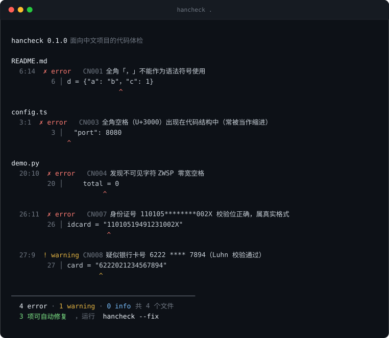

<div align="center">

# hancheck

**AI 写的代码，中文坑特别多。提交前先把它们找出来。**

[](https://github.com/DIUDIU1HAO/hancheck/actions/workflows/ci.yml)
[](https://pypi.org/project/hancheck/)
[](https://pypi.org/project/hancheck/)
[](LICENSE)
[](pyproject.toml)

</div>

---

<div align="center">
  
</div>

## 它解决什么问题

你大概遇到过这些情况：

- 从 AI 对话里复制一段 JSON，跑起来报 `JSONDecodeError`，翻来覆去看不出问题——因为引号是 `“ ”`，不是 `" "`。
- Python 报 `IndentationError: unindent does not match any indentation level`，缩进看起来完全正常——因为那几个"空格"是 `U+3000` 全角空格。
- 本地一切正常，一上 Docker 就满屏乱码——因为某个文件是 GBK 编码，只在 Windows 上"碰巧"能读。
- 两个字符串明明一模一样，`==` 却返回 `False`——因为其中一个中间藏了 `U+200B` 零宽空格。
- 测试数据里写着真实手机号和身份证号，跟着仓库一起被公开了。

这些问题的共同点是：**只在中文环境里发生，肉眼极难发现，而且 AI 生成代码时出现频率最高。**

现有工具帮不上忙。`zhlint`、`autocorrect` 是做**文案排版**的，只检查字符串和注释里的中英文空格；它们不会告诉你这个逗号会让程序崩溃。`ruff`、`eslint` 不认识全角字符，把它们当普通字符放过去。

`hancheck` 补的就是这个缺口：**只判断一件事——这段中文会不会让代码跑不起来、或者悄悄出错。**

## 五秒上手

```bash
pip install hancheck

hancheck .            # 体检当前项目
hancheck --fix .      # 修掉能安全修的部分
hancheck --html report.html .   # 生成可分享的报告
```

零第三方依赖，Python 3.8+ 即可。不装也能跑：

```bash
git clone https://github.com/DIUDIU1HAO/hancheck && cd hancheck
python -m hancheck .
```

每条问题都会指出文件、行列、原因与修复建议；`^` 指示符已做 CJK 宽度修正，中文行不会错位。

## 12 条规则

| 编号 | 级别 | 检查内容 |
|------|------|----------|
| `CN001` | error | 代码结构中出现全角标点（`，` `（）` `：` 等），直接导致语法/解析错误 |
| `CN002` | warning | 字符串中出现**不成对**的中文引号，典型的半角/全角混用 |
| `CN003` | error | `U+3000` 全角空格、`U+00A0` 不换行空格充当缩进 |
| `CN004` | error | 零宽字符 `U+200B/200C/200D/2060/FEFF`，肉眼不可见 |
| `CN005` | error | 文件为 GBK/GB18030 编码，或带 UTF-8 BOM |
| `CN006` | warning | 硬编码中国大陆手机号（已排除 `13800138000` 等公开假号） |
| `CN007` | error | 硬编码身份证号（按 GB 11643 校验位算法确认是真号） |
| `CN008` | warning | 疑似银行卡号（Luhn 校验通过） |
| `CN009` | warning | 源码中引用中文路径，跨平台迁移易失效 |
| `CN010` | info | 标识符含中文，影响 grep / 搜索 / 国际化协作 |
| `CN011` | warning | 代码结构中出现全角数字或字母 `０１２` `ＡＢＣ` |
| `CN012` | error | 存在乱码替换字符 `U+FFFD`，原字符已永久丢失 |

`hancheck --list-rules` 可查看每条规则的判定依据。

## 关键设计：只在"该报的地方"报

这是 hancheck 与所有字符级检查工具的分水岭。

它会把文件切成 **代码结构 / 字符串 / 注释 / 正文** 四类区域，然后**分区定级**：

```python
# 注释里的中文标点，是正常写作 —— 放过
# 这里用逗号、句号、问号，都没问题。

msg = "你好，世界"        # 字符串里的全角逗号，语法合法 —— 放过

data = {"a": 1，"b": 2}   # 代码结构里的全角逗号，必然崩 —— 报错
```

因为这条设计，你可以放心地在一个中文项目上直接跑 `hancheck .`，不会被几百条"中英文之间缺空格"之类的提示淹没。**误报率低是这类工具能活下来的唯一理由。**

Markdown 文件同理：正文不检查，只有围栏代码块内的内容才会被当作代码。

## 自动修复的安全边界

`--fix` 只改那些能百分百确定语义的字符：

| 会修 | 不会修 |
|------|--------|
| 代码结构中的全角标点 → 半角 | 字符串内的中文标点（可能有业务含义） |
| 全角空格 → 普通空格 | 中文变量名（可能全项目都在用） |
| 零宽字符 → 删除 | 手机号 / 身份证号（需人工判断如何脱敏） |
| GBK 文件 → UTF-8 | 无法确定对应半角的符号（`￥` `—` `…`） |

修复是原子的，且**一次收敛**——不会出现"跑两遍才能干净"的情况。

## 接入 CI

```yaml
- name: hancheck
  run: |
    pip install hancheck
    hancheck --fail-level warning .
```

`--fail-level` 可选 `error`（默认）/ `warning` / `info` / `none`。
退出码：`0` 通过，`1` 达到阈值，`2` 参数或路径错误。

JSON 输出供其他工具消费：

```bash
hancheck --json . | jq '.summary'
```

## 作为 Agent Skill 使用

仓库内附带 `skills/hancheck/`，可被 Claude Code、Cursor、Codex 等支持 Agent Skills 的客户端直接调用。装好之后，智能体在交付代码前会自动跑一轮体检，而不是等你手动执行。

纯 CLI 同样好用——它本来就不依赖任何模型。

## 与其他工具的关系

| | hancheck | zhlint / autocorrect | ruff / eslint |
|---|---|---|---|
| 目标 | 代码能否正确运行 | 文案排版是否美观 | 语言级代码规范 |
| 全角标点 | 只报代码结构中的 | 统一文案标点风格 | 不识别 |
| 不可见字符 | 支持 | 不支持 | 部分 |
| GBK / BOM | 支持 | 不支持 | 不支持 |
| 敏感信息 | 手机号/身份证/银行卡 | 不支持 | 需插件 |

三者互补，不冲突。建议同时使用。

## Roadmap

- [ ] VS Code 扩展，保存时实时提示
- [ ] `--baseline` 支持，只报新增问题，便于存量项目接入
- [ ] 中文域名、统一社会信用代码检测
- [ ] 输出 SARIF，接入 GitHub Code Scanning

## 贡献

欢迎提交新的规则，但请先读 [CONTRIBUTING.md](CONTRIBUTING.md)：**一条规则只有同时满足"中文语境专属、判定依据明确、误报代价低"三个条件才会被合并。**

## License

[MIT](LICENSE)
